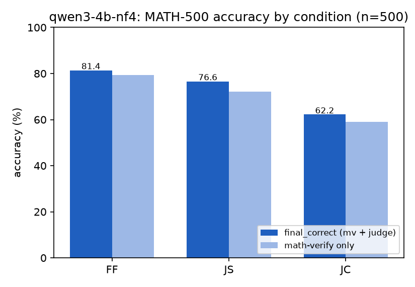
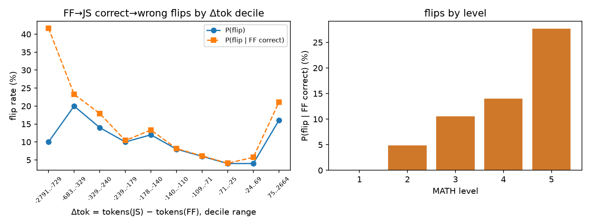
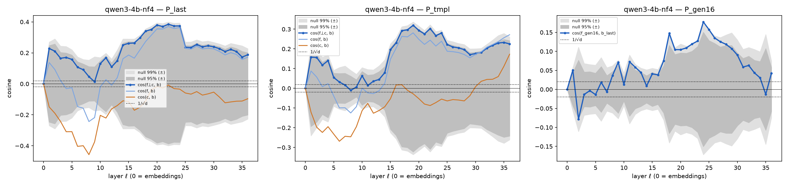
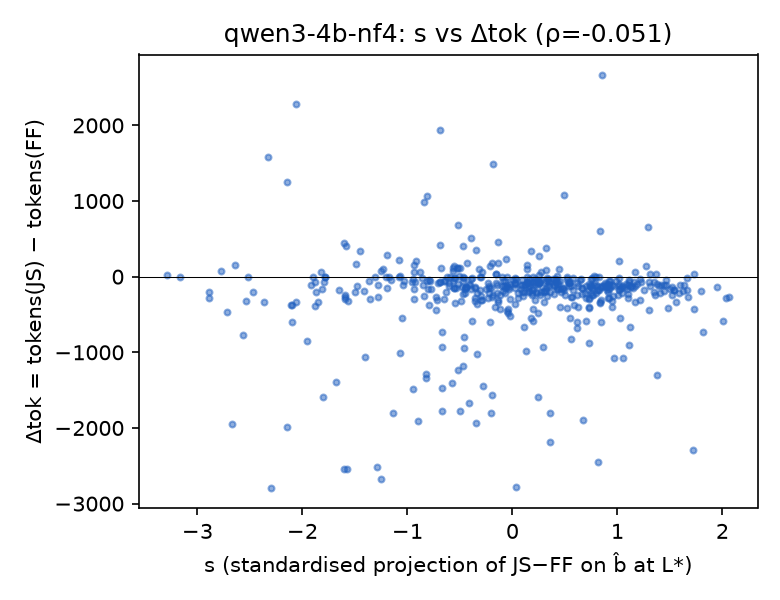
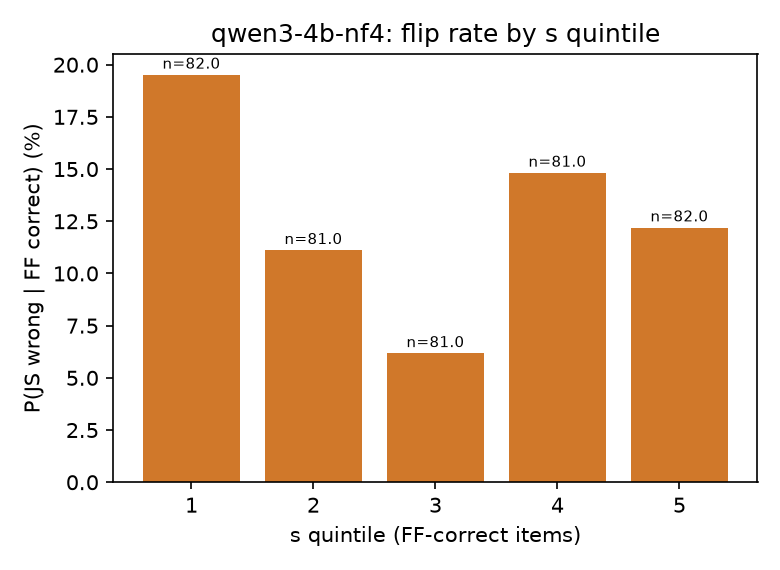
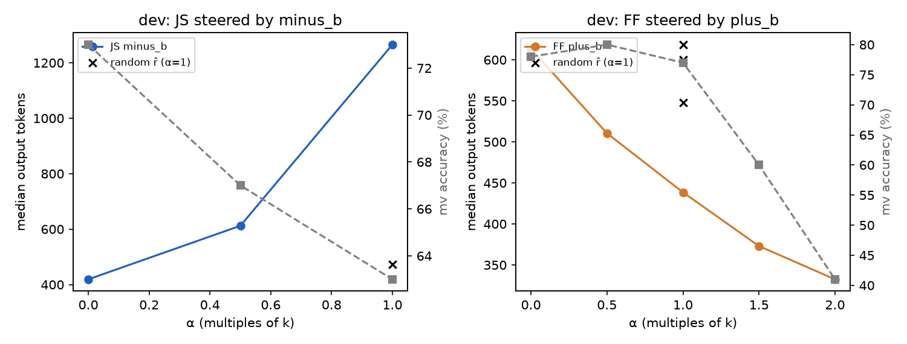

# Is the Format Tax a Brevity Tax? A Mechanistic Study of JSON-Induced Reasoning Degradation in Qwen3-4B

**Project:** `format-tax-mi` · **Model organism:** Qwen3-4B (NF4, non-thinking) · **Judge:** Qwen3-8B (NF4, thinking) · **Benchmark:** MATH-500
**Experiments:** E0 (tax replication), E1 (direction extraction and the H1 test), E3 (causal steering)
**Code and artefacts:** this repository. Every number below is read from files under `outputs/`, `results/` and `reports/`.

---

## Abstract

Open-weight LLMs lose reasoning accuracy when asked to answer in a structured format such as JSON, an effect recently named the *format tax*. Lee et al. (2026) showed behaviourally that the tax is driven mainly by the format-requesting **prompt**, not by constrained decoding, and that structured answers are usually **shorter** than free-form ones. We ask the mechanistic question: does the JSON instruction work, internally, partly as a hidden "be concise" instruction?

On Qwen3-4B and MATH-500 we (i) replicate the tax: −4.8 pp for a JSON prompt [95% CI 1.4–8.2], −19.2 pp with grammar-constrained decoding, and no loss when free-form reasoning is reformatted afterwards. We (ii) extract a format direction *f*, a brevity direction *b* and a neutral control *c* from the residual stream. We (iii) test whether the format shift contains a brevity component and whether that component predicts which questions are hurt. We (iv) steer the model causally along *b*.

The format-specific residual f⊥c has cosine 0.385 with b at layer 22, while the length-matched neutral control has none (−0.01). This alignment is significant under correctly calibrated nulls (p = 0.001). The pre-registered sign-flip null turns out to be miscalibrated for this statistic, and we document why. The brevity push is, however, almost identical for every question, so it does **not** predict per-question compression or failures (Spearman ρ = −0.05; flip OR = 0.98).

Causally, adding only the format-induced brevity push to a plain prompt is **sufficient** to reproduce the format tax's behavioural signature on all 500 problems. It recovers 82% of JSON's mean compression and costs 5.8 pp of accuracy [2.2, 9.4] (JSON: 4.8 pp), with the same right→wrong flip count as JSON (67 vs 67). A random direction of equal norm does neither, although the accuracy gap between the brevity push and the random push is only borderline (p = 0.063). The reverse test (removing the brevity push from JSON prompts) was blocked by a pre-registered safety rule: the brevity direction also encodes terse, un-formatted *style*, and subtracting it breaks the JSON. Necessity therefore remains open.

---

## 1. Introduction

### 1.1 What is the format tax?

Production LLM systems routinely ask models to return **structured output**: JSON objects for APIs, tool calls and agents, and XML, YAML or Markdown for downstream parsers. Two mechanisms enforce such formats:

1. **Prompting:** the instruction describes the required format ("Format your entire response as a single JSON object…").
2. **Constrained decoding** (also called structured generation, grammar-constrained decoding or JSON mode): at each step the decoder masks every token that would violate a grammar or JSON Schema, so the output is guaranteed to parse.

The **format tax** is the drop in task performance that occurs when a model must answer in such a format instead of free-form text:

$$\text{tax}(X) = \text{Acc}(\text{free-form}) - \text{Acc}(\text{format } X).$$

For reasoning tasks the tax matters in practice. A model that solves a math problem in prose but fails when asked to put the same reasoning in a `"reasoning"` field is paying a hidden cost exactly where structured output is used most.

### 1.2 What existing work has established

- **Tam et al. (2024), *Let Me Speak Freely?*,** first reported systematically that format restrictions (JSON, XML, YAML, JSON mode) degrade LLM reasoning, and that stricter restrictions degrade it more.
- **The developers of the Outlines library (dottxt, 2024)** rebutted parts of that evaluation. They argued that, with suitable prompts, structured generation need not hurt and can even help. This made the source of the degradation contested: is it the format, the prompt, or the decoder?
- **Lee, D'Antoni & Berg-Kirkpatrick (2026), *The Format Tax*,** is the most systematic study to date: 10 models, 4 formats (JSON, XML, Markdown, LaTeX) and 4 tasks including MATH-500.
  - **Decomposition.** They compare free-form, *prompted format without constraint* (their "G·T·") and *prompted format with grammar-constrained decoding* ("G·TC"). The **prompt is the dominant cause**: 36 of 39 significant open-weight cells degrade under the prompt alone, with average deltas of −3.9 pp (prompt) vs −1.6 pp (decoder). Constrained decoding raises format compliance from 55.7% to 92.2% while leaving accuracy roughly flat.
  - **Compression.** 71% of structured outputs are **shorter** than their free-form counterparts (median −162 tokens). Per-question flip rates are **U-shaped** in the token difference: they exceed 40% at the extremes of compression and expansion.
  - **Mitigations.** Schema descriptions and few-shot examples leave most of the tax intact. Separating reasoning from formatting (two-turn generation, or extended thinking) recovers most of it.
  - **Scope.** The analysis is explicitly behavioural.
- **Fan (2026), *Capacity, Not Format*,** argues the tax is capacity-dependent. It is negligible for strong models on easy tasks and large for weaker models on hard ones (e.g. −36 pp for a small model on MATH-Hard). Delaying the structure recovers most of the loss, and part of the penalty is truncation that larger token budgets remove.
- **Constrained-decoding papers** (DOMINO, Grammar-Aligned Decoding, CRANE) study the decoder side. Constraints can distort the model's distribution or misalign with tokenisation, and grammars that leave room for reasoning preserve accuracy.

### 1.3 The gap we study

Every study above measures **whether, how much, where (prompt vs decoder) and for which models** the tax occurs, and **how to mitigate** it. All of them treat the model as a black box. Two observations from that literature point toward a mechanism nobody has tested:

- structured answers are systematically **shorter** (Lee et al., 2026), and
- shortening reasoning is known to cost accuracy on hard problems (Section 3.4), while separating reasoning from formatting removes the tax.

This suggests a specific hypothesis: **the format-requesting prompt induces an internal state that overlaps with the state induced by an explicit "be concise" instruction, and that overlap drives the compression and the accuracy loss.** Testing it requires looking inside the model:

1. Is there such an overlap in the residual stream?
2. Does it explain *which* questions are hurt?
3. Is it *causally* sufficient, or necessary, for the tax?

These are the questions this work addresses.

---

## 2. Our contributions

1. **A controlled replication of the format tax with pre-registered analysis.** On Qwen3-4B (NF4) and MATH-500, a JSON prompt costs **4.8 pp** [1.4, 8.2] (exact McNemar p = 0.0097). JSON with grammar-constrained decoding costs **19.2 pp**. Reformatting finished free-form reasoning (two-turn) costs **nothing** (−1.0 pp [−2.2, 0.0]). We replicate the U-shaped flip-vs-length curve and the concentration of failures on hard problems (27.7% flip rate at level 5 vs 0% at level 1). Labels come from math-verify plus a format-blind LLM judge that agreed with human labels on **98/98** audited items (κ = 1.0).
2. **A practical finding about format prompts.** A JSON instruction that embeds the raw JSON Schema made Qwen3-4B **echo the schema itself** instead of answering (9 of 10 smoke-test items). Our replication uses a revised instruction with an inline example of the output shape, which removes the artefact.
3. **Representation-level evidence for a "hidden brevity instruction".** We extract the format direction *f* (JSON minus free-form), the brevity direction *b* (concise minus detailed) and a length-matched neutral control *c*. The format-specific residual f⊥c aligns with b (**cos = 0.385 at layer 22**, from about layer 14 onward), while appending neutral text does not (cos(c, b) = −0.01). At layer 22 the JSON prompt moves activations **about halfway** from free-form toward an explicit "be concise" prompt.
4. **A methodological correction.** The pre-registered sign-flip null for a *cosine* statistic is **miscalibrated** when the mean shift is strong. Its draws correlate r ≈ 0.89 with the mean of the random signs, so the null tracks the observed value. Balanced or centred nulls fix this and give p = 0.001. The verdict on the pre-registered criterion is still reported as specified.
5. **A clean per-question null result.** The brevity push is nearly the same for every question (SD 2.7 against a mean shift of 15.5), so it predicts neither per-question compression nor flips. The bias is a **population-level offset**, not a question-specific signal.
6. **Causal sufficiency via activation steering.** Adding k·b̂ (the push the JSON prompt itself adds) to a plain prompt reproduces:
   - **82%** of JSON's mean compression;
   - **5.8 pp** of accuracy loss [2.2, 9.4] (JSON: 4.8 pp);
   - the **same flip profile** (67 flips / 32 rescues vs JSON's 67 / 31).

   An equal-norm random direction barely changes length. The specificity of the *accuracy* loss relative to the random control is borderline (p = 0.063).
7. **A diagnostic negative result for necessity.** Subtracting b from JSON prompts lengthens reasoning but also reinstates free-form markdown style inside the JSON string, collapsing JSON validity. The brevity direction is **entangled with formatting style**, which a pre-registered safety rule detected before any evaluation data was touched.
8. **Validated infrastructure.**
   - A resumable pipeline (vLLM generation, HF activations, judge, audit).
   - A residual-stream steering hook for vLLM, verified against HF (40/40 top-1 agreement).
   - Two pitfalls documented: **prefix caching silently reuses un-steered KV caches**, and HF decoder layers now return tensors rather than tuples.

---

## 3. Related work

We group prior work by **what** it studies about structured output and reasoning, and **how**.

### 3.1 Behavioural measurement of the format tax

| Work | Question | Method | Key finding |
|---|---|---|---|
| Tam et al., 2024 (EMNLP Industry) | Do format restrictions hurt LLM reasoning? | Accuracy comparisons across formats and restriction strengths | Significant degradation; stricter formats hurt more |
| dottxt (2024, blog) | Is the degradation an artefact of evaluation? | Re-evaluation with revised prompts | Structured generation need not hurt (argued by a tool developer) |
| Long et al., 2025 (NAACL) | Are LLMs biased toward output formats? | Systematic format-bias evaluation and mitigation | Performance varies significantly across formats |
| Lee, D'Antoni & Berg-Kirkpatrick, 2026 | How large is the tax, and does it come from the prompt or the decoder? | 10 models × 4 formats × 4 tasks; free-form vs G·T· vs G·TC | Prompt-dominant tax; structured outputs are shorter; U-shaped flips; two-turn and extended thinking recover it |
| Fan, 2026 | Is the tax intrinsic or capacity-dependent? | 4 API models, 5 benchmarks, prose-length control, delayed structure, token budgets | Penalty depends on capacity and task difficulty; delayed structure recovers ~80% |

These works measure the tax at the level of **inputs and outputs**. They establish its existence, its size, its prompt-level origin and its correlation with shorter outputs, but do not look inside the model.

### 3.2 Constrained decoding and its distortions

- **Methods:** Outlines (Willard & Louf, 2023), grammar-constrained decoding for structured NLP (Geng et al., 2023), XGrammar (Dong et al., 2024), and the JSONSchemaBench study of structured-output engines (Geng et al., 2025).
- **Distortion analyses:**
  - DOMINO (Beurer-Kellner et al., 2024) shows that constraints misaligned with sub-word tokenisation hurt accuracy.
  - Grammar-Aligned Decoding (Park et al., 2024) shows that grammar-constrained decoding distorts the model's distribution, and proposes a sampler that corrects this.
  - CRANE (Banerjee et al., 2025) shows that grammars which leave room for intermediate reasoning preserve accuracy.

This line studies the **decoder**. Our JC condition (JSON prompt plus grammar) touches it, but our mechanistic question concerns the **prompt** component that Lee et al. identify as dominant.

### 3.3 Prompt-format sensitivity

Sclar et al. (2024) and He et al. (2024) show that LLM performance is highly sensitive to superficial *input* formatting: separators, casing, templates. That literature concerns **how the prompt is formatted**. The format tax concerns **what output format the prompt requests**. Our neutral control *c* (a length-matched paragraph appended to the prompt) is designed to separate "extra instruction text" from "a format request".

### 3.4 Reasoning length and accuracy

- **Longer reasoning helps.** Chain-of-thought (Wei et al., 2022) showed that intermediate reasoning improves accuracy, and test-time-scaling work (e.g. s1, Muennighoff et al., 2025) shows that forcing longer reasoning can raise accuracy further.
- **Shorter reasoning has a cost, which depends on difficulty.** Work on concise reasoning (Renze & Guven, 2024; Nayab et al., 2024; Han et al., 2024; Xu et al., 2025) finds that compression can preserve accuracy on easier problems but costs accuracy on harder ones.

This motivates our hypothesis: if format prompts compress reasoning, they should hurt mainly hard problems, which is what we and Lee et al. observe.

### 3.5 Linear representations and activation steering

- **The representation framework.** The residual stream is the shared communication channel of a transformer (Elhage et al., 2021), and many high-level concepts are linearly represented in it (Park, Choe & Veitch, 2024; Marks & Tegmark, 2023).
- **Steering.** Difference-of-means directions from contrasting prompts can be added to steer behaviour: ActAdd (Turner et al., 2023), Contrastive Activation Addition (Panickssery et al., 2024), Representation Engineering (Zou et al., 2023) and Inference-Time Intervention (Li et al., 2023).
- **Ablation.** Projecting such directions out can remove behaviour; refusal, for example, is mediated by a single direction (Arditi et al., 2024).

Our *f*, *b* and *c* are difference-of-means directions of this kind, and E3 is an activation-addition experiment.

### 3.6 Steering reasoning length

- **ThinkEdit** (Sun, Yan & Weng, 2025) finds a linear direction that governs reasoning length in reasoning models. Steering toward short reasoning lowers accuracy, and editing a few attention heads mitigates overly short reasoning.
- **Activation-Steered Compression** (Azizi et al., 2025) uses a concise-vs-verbose steering vector to shorten chain-of-thought for efficiency.
- **Venhoff et al. (2025)** steer reasoning behaviours of thinking models with steering vectors.

These works show that **length is linearly steerable**, but they study length as a goal in itself (efficiency, or curing overthinking and underthinking), not as a by-product of a format request.

### 3.7 How our work differs

| | Behavioural format-tax studies (3.1) | Constrained-decoding studies (3.2) | Length-steering studies (3.6) | **This work** |
|---|---|---|---|---|
| Object of study | Accuracy under formats | Decoder distortion | Reasoning length | **The internal state induced by a format prompt** |
| Level | Input/output | Decoder probabilities | Residual stream | **Residual stream** |
| Links format to length? | Correlational (shorter outputs) | No | No (no format) | **Geometric and causal** |
| Causal intervention? | Prompt or decoding changes | Decoder changes | Steering | **Steering with the format-induced brevity component, k = f·b̂** |
| Per-question prediction? | Flip vs Δtok curves | No | No | **Pre-registered projection test** |

**What we contribute uniquely:**
- **The first representation-level account of the format tax.** The JSON prompt carries a brevity component that is specific to the format request, not to extra prompt text.
- **A causal sufficiency test** showing that this component alone reproduces the tax's behavioural signature.
- **The finding that the brevity representation is entangled with formatting style**, which explains why a simple "remove the brevity push" intervention cannot isolate necessity.

All of this was done under a pre-registration discipline: frozen layers, held-out evaluation, gates and pre-specified safety rules.

---

## 4. Hypotheses and experimental design

### 4.1 Hypotheses

- **H0 (replication).** On our model and setup, a JSON-requesting prompt lowers MATH-500 accuracy relative to free-form, and the loss arises from reasoning under the format request, not from the JSON syntax itself.
- **H1 (geometric and predictive).** The residual-stream shift induced by the JSON instruction contains a component aligned with an independently extracted brevity direction.
  - **H1a, geometric:** the format-specific residual f⊥c is aligned with b beyond chance.
  - **H1b, predictive:** a question's projection onto b predicts its output compression and its correct→wrong flips.
- **H2 (causal).** The brevity component is causally involved in the tax.
  - **H2-S, sufficiency:** adding the format-induced brevity push to a free-form prompt shortens reasoning and lowers accuracy, more than an equal-norm random push.
  - **H2-N, necessity:** removing the brevity push from the JSON prompt lengthens reasoning and recovers accuracy, while keeping JSON output intact.

### 4.2 Experiment overview

| Exp. | Purpose | Main manipulation | Data | Gate / pre-registration |
|---|---|---|---|---|
| **E0** | Test H0: measure the tax | Prompt conditions FF, JS, JC, 2T | MATH-500 (500) | Gate: tax(FF−JS) ≥ 3 pp and McNemar p < 0.05; human audit of the judge (≥ 95% agreement, ≥ 90% on flip items) |
| **E1** | Test H1a, H1b | Activation contrasts FF, JS, NC, C₁₋₃, D₁₋₃ | Extraction set (300 MATH-train) for directions; MATH-500 for prediction | L* frozen on extraction data before any eval activation; behavioural brevity check; H1 criteria (i)–(iii) |
| **E3** | Test H2-S, H2-N | Activation addition ±k·b̂ at L* | Dev set (100 MATH-train) for calibration; MATH-500 for the test | α frozen on dev; pre-specified safety rule; criteria S1–S2 and N1–N3 |

(The project plan numbers its experiments E0, E1, E3. E2 was not part of this study.)

### 4.3 Design principles

- **Paired design.** Every comparison is paired by problem (same 500 MATH-500 uids), so per-question differences are tested with exact McNemar and paired bootstrap tests.
- **Data separation.** Directions and layers are chosen on the extraction set (MATH train). Steering doses are calibrated on a disjoint dev set (MATH train). MATH-500 is touched only after these choices are frozen.
- **Controls.**
  - A **neutral, length-matched** appended paragraph (NC) separates "a format request" from "more prompt text".
  - **Random directions**, orthogonal to b and f and of equal norm, separate "the brevity direction" from "any perturbation of that size".
  - **Two-turn (2T)** separates "JSON syntax" from "reasoning under a JSON instruction".
- **Pre-registered criteria and gates**, reported component by component and never collapsed into a single pass/fail.

---

## 5. Experiments

### 5.1 Model organism and compute

| Item | Setting |
|---|---|
| Generator (model organism) | **Qwen3-4B**, the hybrid-thinking checkpoint, with thinking **off** (`enable_thinking=False`). 36 decoder layers, d_model = 2560, tied embeddings |
| Judge | Qwen3-8B, thinking **on**, run in HF transformers (it does not fit in vLLM on this GPU) |
| Precision | bitsandbytes **NF4**, double quantisation, bf16 compute, for generation (vLLM) and for activations (HF) alike |
| Hardware | One RTX 4060 Laptop GPU (8 GB, sm_89) under WSL2 (Ubuntu 24.04); about 6.9 GiB usable |
| Software | vLLM 0.31.0 with the official `vllm-bnb-plugin` 0.0.3 (in-flight NF4 and double quant verified from source), transformers 5.17.0, bitsandbytes 0.50.2, torch 2.13 (CUDA 13.2), math-verify |
| vLLM engine | `gpu_memory_utilization` 0.80, `max_model_len` 4096 (7168 for 2T), `max_num_seqs` 8, eager mode, seed 0 |
| vLLM–HF parity | Next-token distribution on 40 prompts: top-1 agreement **40/40**, mean KL 0.004 (unsteered); **40/40** under steering |

Qwen3-8B was planned as a second generator but was dropped by decision. In NF4 its weights alone take 5.97 GiB, and the vLLM KV cache stayed negative after every permitted memory setting had been tried.

### 5.2 Datasets

| Split | Source | Size | Use |
|---|---|---|---|
| **Evaluation** | `HuggingFaceH4/MATH-500` (test) | 500 | E0 tax; E1 per-question test; E3 test. Gold answers from the `answer` field |
| **Extraction set** | `EleutherAI/hendrycks_math`, train, 7 subjects | 300 | E1 directions, nulls and the L* choice |
| **Dev set** | Same source, disjoint from the extraction set | 100 | E3 dose calibration and safety check only |

Both train-derived sets were drawn by stratified sampling (subject × level, proportional allocation with largest-remainder rounding, seed 0) from the 7,500 train problems. **No** train problem overlapped MATH-500 after whitespace normalisation. The extraction set's levels are 23 / 54 / 64 / 68 / 91 (levels 1–5).

### 5.3 Prompt conditions

All prompts use Qwen3's chat template with no system message. Each rendered prompt is stored with its SHA-256 hash. The task stem is "Solve the following math problem. Reason step by step, and state the final answer clearly at the end. Problem: …".

| Code | Name | User message | Decoding |
|---|---|---|---|
| **FF** | Free-form | task | greedy, ≤ 3072 tokens |
| **JS** | JSON prompt | task + FORMAT_BLOCK | greedy |
| **JC** | JSON prompt + grammar | task + FORMAT_BLOCK | greedy, JSON-Schema-constrained (`{"reasoning": str, "answer": str}`) |
| **2T** | Two-turn reformat | [task] → FF answer → REFORMAT_BLOCK | greedy |
| **NC** | Neutral control | task + length-matched neutral paragraph (83 vs 85 tokens) | activations only |
| **C_k / D_k** | Concise / detailed, k = 1..3 | task + "Be concise…" / "Be thorough…" (three paired phrasings) | activations, plus a behavioural check |

**FORMAT_BLOCK (final version).** "Format your entire response as a single JSON object with exactly two keys, in this order: `"reasoning"` (your step-by-step reasoning) and `"answer"` (only your final answer). Your output must have this shape: `{"reasoning": "<…>", "answer": "<…>"}`. Output only the JSON object, with no text before or after it."

The first version embedded the full JSON Schema in a code fence. In a 10-problem smoke test, Qwen3-4B returned the schema itself in 9/10 cases. The block was revised before any full run, by the study owner's decision, and the neutral paragraph was length-matched again.

**Template invariants** were verified by unit tests:
- FF and JS differ only by the appended block.
- The 9-token post-instruction span `<|im_end|>\n<|im_start|>assistant\n<think>\n\n</think>\n\n` is token-identical across all conditions.
- NC is within ±15% of FORMAT_BLOCK's length.

### 5.4 Scoring pipeline (E0)

1. **JSON validity.** *Strict* means `json.loads` succeeds and both keys are strings. *Lenient* also allows a code fence, or the substring from the first `{` to the last `}`.
2. **Answer extraction.**
   - JSON conditions: the `answer` field, else a regex on the `"answer"` field, else nothing. Boxed content is taken if present.
   - FF: the last `\boxed{…}`, found with a balanced-brace parser, else a "final answer" line.
   - LaTeX commands mangled by JSON escapes (e.g. `\frac` read as a form feed followed by "rac") are repaired. This affected 5 items.
3. **math-verify** (primary). `verify(parse(gold), parse(candidate))`, with gold first.
4. **LLM judge** (secondary).
   - **Which items:** every math-verify-incorrect item, plus a 10% calibration sample of math-verify-correct items.
   - **What the judge sees:** a format-blind input containing the problem, gold answer, extracted answer and the last 800 characters of reasoning, with no JSON syntax and no condition name.
   - **Settings:** Qwen3-8B thinking mode; T = 0.6, top-p 0.95, top-k 20; 2,048 new tokens.
   - **Final label:** math-verify if it says correct; otherwise the judge's verdict; a judge failure counts as incorrect.
5. **Validation.**
   - Self-consistency reruns with seeds 1 and 2 on 100 items.
   - A **blinded human audit** of 98 items: 48 math-verify-wrong items the judge marked EQUIVALENT, 30 the judge marked NOT_EQUIVALENT, and 20 calibration items. The audit was a hard gate (≥ 95% overall agreement, ≥ 90% on flips).

### 5.5 Statistics (E0)

- **Tax:** a paired bootstrap over uids (10,000 resamples) gives the 95% CI.
- **Paired tests:** exact McNemar for FF–JS, FF–JC, JS–JC and FF–2T.
- **Flip analysis:** flips are FF ✓ and JS ✗. Flip rate is reported by deciles of Δtok = tokens(JS) − tokens(FF), and by MATH level.

### 5.6 Activation extraction and directions (E1)

- **Residual stream.** r_ℓ is the output of decoder block ℓ, captured with forward hooks; r_0 is the token embeddings.
  - The hooked values match HF `hidden_states[ℓ]` exactly for ℓ < 36.
  - `hidden_states[-1]` is post-RMSNorm and is therefore *not* used.
  - Activations are stored in fp16 and all statistics are computed in fp32/fp64.
- **Positions.**
  - **P_last** (primary): the last prompt token.
  - **P_tmpl:** the mean over the 9-token post-instruction span.
  - **P_gen16:** the mean over the first 16 *content* tokens of an 80-token greedy continuation, teacher-forced. For JS, content starts after the `{"reasoning": "` scaffold; 49/300 JS items without the scaffold were excluded.
- **Directions,** computed per layer and position from paired differences over the 300 extraction problems:
  - format direction f = mean(r(JS) − r(FF));
  - neutral direction c = mean(r(NC) − r(FF));
  - brevity directions b^(k) = mean(r(C_k) − r(D_k)), with b = mean_k b^(k);
  - format-specific residual f⊥c = f − (f·ĉ)ĉ.
- **Behavioural validity of b.** On 50 extraction problems, the median length of C₁ answers was 224.5 tokens vs 525.5 for D₁. The ratio of **0.43** meets the ≤ 0.6 requirement.
- **Statistics.**
  - Cosines: cos(f, b), cos(f⊥c, b), cos(c, b), cos(f, c).
  - Phrasing robustness: cos(b^(j), b^(k)).
  - Sign-flip null: 1,000 draws of f_null = mean(s_i·d_i) with random s_i = ±1, giving cos(f_null⊥c, b).
  - Split-half reliability over 100 random splits.
  - The analytic random-direction scale 1/√d = 0.020.
- **Pre-registered layer.** L* = argmax over ℓ ∈ [9, 31] of cos(f⊥c_ℓ, b_ℓ) at P_last, computed on the extraction set and frozen together with b̂ before any MATH-500 activation was extracted. The result was **L* = 22**.

### 5.7 Per-question test (E1, §8.5)

- **Projection score.** For each MATH-500 problem i, s_i = (r_22(JS_i) − r_22(FF_i))·b̂, standardised across problems.
- **Tests:**
  1. Spearman(s, Δtok), with a bootstrap CI. It is also computed against Δtok measured on the JSON reasoning field.
  2. A logistic regression on FF-correct items: JS_incorrect ~ s + C(level) + log(tokens_FF).
  3. A negative control in which 1,000 random unit directions replace b̂.
- **H1 criteria** (pre-registered):
  - (i) cos(f⊥c, b) at L* exceeds the null p99;
  - (ii) Spearman < 0 with a CI excluding 0, **or** flip OR > 1 with p < 0.05;
  - (iii) the real statistic exceeds the 95th percentile of the random-direction control.

### 5.8 Causal intervention (E3)

- **Intervention.** Activation addition: a fixed vector *v* is added to the residual stream at the output of block L* = 22, at **every** position (prompt and generated tokens).
- **Vectors.** The magnitude is set by the model's own format shift: k = f·b̂ = **15.53**, i.e. the push the JSON prompt adds along b̂ at L*. For reference, ‖f‖ = 41.9 and the typical residual-stream norm at layer 22 is about 66, so k·b̂ is about 23% of it.
  - **E3-S (sufficiency):** FF + α·k·b̂.
  - **E3-N (necessity):** JS − α·k·b̂.
  - **Random controls:** ±α·k·r̂, where r̂ is Gaussian, orthogonalised against b̂ and f̂, and scaled to the same norm (seeds 100–104).
  - **Positive control E3-F:** JS − f (removing the whole format shift).
- **Implementation in vLLM.** vLLM's Qwen3 decoder layer returns (mlp_out, residual) and fuses the addition into the next layer's RMSNorm, so *v* is added to the returned `residual`.
  - **Eager mode** keeps the forward hooks live.
  - The engine runs **in-process**, so the hook is installed via `LLM.apply_model`.
  - **Prefix caching is disabled.** Otherwise vLLM silently reuses KV blocks computed under a different (or no) steering vector.
  - A per-setting hook token counter verifies that every prompt and generated token was steered.
- **Validation before the test.**
  - **Manipulation check (HF, 20 dev prompts):** −k·b̂ removes 97% of the JS–FF gap along b̂ at layer 22, and 63–103% of it in layers 23–36.
  - **Steered parity:** vLLM and HF agree on the top-1 next token for 40/40 steered prompts.
- **Dev calibration.** The dose grid α ∈ {0.5, 1, 1.5, 2} and the random controls were run on the 100 dev problems. A **pre-specified safety rule** gates α = 1 for each arm: the rate of degenerate outputs (truncated with a repetitive or blank tail) may rise by at most 5 pp, and, for JS, lenient JSON validity may drop by at most 5 pp.
- **Pre-registered criteria.**
  - **S1:** tokens(FF + b) < tokens(FF), and < tokens(FF + random), each by one-sided paired Wilcoxon, p < 0.05.
  - **S2:** acc(FF) − acc(FF + b) > 0, with a paired bootstrap CI excluding 0, plus exact McNemar.
  - **N1–N3** were the analogous necessity criteria, with a JSON-validity guard.
- **Labels.** E3-S was judged with the E0 rule. The random control was scored with math-verify only, by the study owner's decision.

### 5.9 Deviations from the original plan (all logged in `reports/DEVIATIONS.md`)

| # | Deviation | Reason / decision |
|---|---|---|
| D0 | vLLM bnb via the official plugin; torch is a CUDA 13.2 build | vLLM ≥ 0.30 removed in-tree bnb. NF4 and double quant verified from source |
| D2 | `gpu_memory_utilization` 0.80 (planned 0.88) | Windows reserves about 1 GiB of the 8 GB GPU |
| D3 | Qwen3-8B dropped as a generator | Does not fit in vLLM (user decision) |
| D4 | Judge in HF transformers, batch size 1 | Same memory limit (user decision) |
| D5 | FORMAT_BLOCK and REFORMAT_BLOCK revised | Schema echo in the smoke test (user decision); neutral block re-matched |
| D6 | 2T run at max_model_len 7168 | 2T prompts contain the full FF answer (user decision) |
| D7 | Hook unwraps tensor-returning decoder layers | transformers 5.17 API change (verified against hidden states) |
| D8 | 49/300 JS items excluded at P_gen16 | Scaffold not found (counted) |
| D9 | Sign-flip null miscalibrated | Reported as specified; corrected nulls added as exploratory |
| D10 | 48 instead of 50 flip items audited | Only 48 existed |
| E3 | Necessity arm not run on MATH-500 | Failed the pre-specified dev safety rule (user decision) |

---

## 6. Results

### 6.1 E0: the format tax on Qwen3-4B

**Table 1. Per-condition results (MATH-500, n = 500).**

| Cond. | Acc. (final) | Acc. (math-verify) | Strict-valid JSON | Lenient-valid JSON | Output tokens, median [IQR] | Reasoning-field tokens, median [IQR] | Truncated | mv-wrong judged | Judge → correct | Judge failed |
|---|---|---|---|---|---|---|---|---|---|---|
| FF | **81.4%** | 79.4% | — | — | 558 [365–1034] | — | 8.2% | 103 | 10 | 20 |
| JS | **76.6%** | 72.2% | 29.2% | 29.4% | 380 [214–796] | 176 [128–252] | 5.2% | 139 | 22 | 24 |
| JC | **62.2%** | 59.0% | 83.4% | 83.4% | 364 [208–736] | 293 [178–459] | 16.6% | 205 | 16 | 16 |
| 2T | **82.4%** | 80.2% | 58.4% | 58.4% | 201 [160–267] | 162 [130–208] | 0.0% | 99 | 11 | 23 |

**Table 2. Format tax = acc(FF) − acc(X), in pp, with paired bootstrap 95% CIs.**

| X | Tax (final labels) | 95% CI | Tax (math-verify only) | 95% CI |
|---|---|---|---|---|
| JS | **+4.80** | [+1.40, +8.20] | +7.20 | [+3.40, +11.00] |
| JC | **+19.20** | [+15.00, +23.40] | +20.40 | [+16.00, +24.80] |
| 2T | **−1.00** | [−2.20, 0.00] | −0.80 | [−2.60, +1.00] |

**Table 3. Exact McNemar tests (final labels).**

| Pair | Both ✓ | A ✓ B ✗ | A ✗ B ✓ | Both ✗ | p |
|---|---|---|---|---|---|
| FF vs JS | 355 | 52 | 28 | 65 | **0.0097** |
| FF vs JC | 293 | 114 | 18 | 75 | 3.0e-18 |
| JS vs JC | 295 | 88 | 16 | 101 | 3.2e-13 |
| FF vs 2T | 406 | 1 | 6 | 87 | 0.125 |

**Table 4. FF → JS flips (52 flips, 28 rescues; median Δtok = −140), by Δtok decile.**

| Decile | Δtok range | n | Flips | P(flip) | n FF ✓ | P(flip \| FF ✓) |
|---|---|---|---|---|---|---|
| 1 | −2791 … −729 | 50 | 5 | 10.0% | 12 | **41.7%** |
| 2 | −683 … −329 | 50 | 10 | 20.0% | 43 | 23.3% |
| 3 | −329 … −240 | 50 | 7 | 14.0% | 39 | 17.9% |
| 4 | −239 … −179 | 50 | 5 | 10.0% | 48 | 10.4% |
| 5 | −178 … −140 | 50 | 6 | 12.0% | 45 | 13.3% |
| 6 | −140 … −110 | 50 | 4 | 8.0% | 49 | 8.2% |
| 7 | −109 … −71 | 50 | 3 | 6.0% | 49 | 6.1% |
| 8 | −71 … −25 | 50 | 2 | 4.0% | 49 | 4.1% |
| 9 | −24 … +69 | 50 | 2 | 4.0% | 35 | 5.7% |
| 10 | +75 … +2664 | 50 | 8 | 16.0% | 38 | **21.1%** |

**Table 5. FF → JS flips by MATH difficulty level.**

| Level | n | Flips | Rescues | P(flip \| FF ✓) |
|---|---|---|---|---|
| 1 | 43 | 0 | 1 | 0.0% |
| 2 | 90 | 4 | 5 | 4.9% |
| 3 | 105 | 10 | 3 | 10.5% |
| 4 | 128 | 15 | 9 | 14.0% |
| 5 | 134 | 23 | 10 | **27.7%** |

**Table 6. Judge validation.**

| Check | Result |
|---|---|
| Human audit (98 blinded items: 48 flip, 30 NOT_EQUIVALENT, 20 calibration) | **98/98 agreement, Cohen's κ = 1.00** (gate: ≥ 95% overall, ≥ 90% on flips) |
| Calibration (math-verify-correct items re-judged) | 106/106 EQUIVALENT (FF 40, JS 36, JC 30) |
| Self-consistency (100 items × seeds 0/1/2) | Three-way 78% overall; **97%** where all three runs returned a verdict; 2 verdict reversals |
| Judge failures (2,048-token thinking cap reached) | FF 20 · JS 24 · JC 16 · 2T 23; all 20 inspected FF cases were genuinely wrong answers |

**Gate:** tax(FF−JS) = 4.80 pp ≥ 3.0 and McNemar p = 0.0097 < 0.05, so the gate **passes**. Truncation exceeds 5% in FF, JS and JC (flagged, since truncation biases the tax).

**Interpretation of E0 (H0 supported).**

- **The JSON prompt costs accuracy.** The tax is 4.8 pp, and its CI excludes 0. In absolute terms it is modest for a single model and benchmark, and consistent in direction and size with Lee et al.'s open-weight results.
- **The tax comes from reasoning under the instruction, not from JSON syntax.** 2T produces the same JSON object, yet costs nothing (−1.0 pp, n.s.), because its reasoning was completed in free form first. This reproduces Lee et al.'s two-turn mitigation.
- **Compression is the visible behavioural change.** The median JS output is 32% shorter than FF's (380 vs 558 tokens), and the reasoning field itself is only 176 tokens.
- **Flips concentrate where compression should hurt most.** They rise steadily with difficulty (0% → 27.7% from level 1 to 5) and peak in the most-compressed decile (41.7%). The **U-shape** (21.1% in the most-expanded decile) replicates Lee et al.; expansions often mark problems where the model was struggling anyway.
- **Grammar-constrained decoding adds a large extra cost for this small 4-bit model.** JC loses 19.2 pp, and 16.6% of its outputs truncate, some in repetition loops. This differs from Lee et al.'s average finding that constrained decoding is nearly free, and we treat it as a separate phenomenon from the prompt-driven tax studied below.




### 6.2 E1: the geometry of the format shift

**Table 7. Direction statistics at P_last (extraction set, n = 300, d = 2560, 1/√d = 0.020).** "Null" is the pre-registered sign-flip null of cos(f_null⊥c, b). L* = 22 is in bold.

| ℓ | cos(f,b) | **cos(f⊥c,b)** | Null p95 | Null p99 | cos(c,b) | cos(f,c) | cos(b¹,b²) | cos(b¹,b³) | cos(b²,b³) | Split-half f | Split-half b | ‖f‖ | ‖b‖ | ‖c‖ |
|---|---|---|---|---|---|---|---|---|---|---|---|---|---|---|
| 1 | 0.137 | 0.228 | 0.247 | 0.270 | −0.149 | 0.446 | 0.088 | −0.030 | 0.027 | 0.998 | 1.000 | 0.7 | 0.1 | 0.7 |
| 4 | −0.031 | 0.170 | 0.199 | 0.241 | −0.309 | 0.558 | −0.047 | 0.148 | 0.043 | 0.998 | 0.999 | 1.7 | 0.3 | 1.4 |
| 8 | −0.243 | 0.046 | 0.111 | 0.153 | −0.457 | 0.613 | 0.149 | 0.251 | −0.080 | 0.999 | 0.998 | 4.6 | 0.5 | 3.2 |
| 12 | −0.009 | 0.109 | 0.135 | 0.160 | −0.162 | 0.595 | 0.546 | 0.588 | 0.533 | 0.999 | 0.999 | 8.1 | 2.6 | 5.0 |
| 15 | 0.186 | 0.262 | 0.273 | 0.290 | −0.114 | 0.436 | 0.673 | 0.633 | 0.642 | 0.999 | 0.999 | 13.4 | 5.1 | 6.7 |
| 18 | 0.273 | 0.341 | 0.341 | 0.355 | −0.112 | 0.377 | 0.832 | 0.776 | 0.750 | 0.999 | 0.999 | 18.8 | 9.9 | 7.7 |
| 20 | 0.355 | 0.380 | 0.382 | 0.394 | −0.016 | 0.320 | 0.908 | 0.878 | 0.859 | 0.999 | 1.000 | 28.3 | 20.9 | 8.4 |
| **22** | **0.370** | **0.385** | **0.387** | **0.399** | **−0.008** | **0.250** | **0.931** | **0.898** | **0.877** | **0.999** | **0.999** | **41.9** | **32.4** | **10.8** |
| 24 | 0.364 | 0.374 | 0.377 | 0.393 | −0.034 | 0.161 | 0.934 | 0.916 | 0.880 | 0.999 | 0.999 | 62.5 | 41.4 | 12.8 |
| 27 | 0.244 | 0.254 | 0.263 | 0.284 | −0.050 | 0.148 | 0.940 | 0.924 | 0.888 | 0.999 | 0.998 | 102.1 | 62.7 | 18.0 |
| 30 | 0.225 | 0.239 | 0.248 | 0.268 | −0.053 | 0.180 | 0.945 | 0.935 | 0.885 | 0.999 | 0.998 | 159.6 | 91.2 | 26.0 |
| 33 | 0.201 | 0.222 | 0.239 | 0.261 | −0.117 | 0.156 | 0.934 | 0.936 | 0.869 | 0.999 | 0.997 | 224.2 | 122.1 | 36.4 |
| 36 | 0.172 | 0.187 | 0.200 | 0.227 | −0.096 | 0.141 | 0.908 | 0.936 | 0.854 | 0.999 | 0.996 | 308.4 | 158.5 | 48.3 |

**Table 8. Secondary positions (selected layers).**

| ℓ | P_tmpl cos(f⊥c,b) | P_tmpl null p99 | P_tmpl cos(c,b) | P_gen16 cos(f, b_last) | P_gen16 null p99 |
|---|---|---|---|---|---|
| 15 | 0.196 | 0.225 | −0.053 | 0.041 | 0.056 |
| 18 | 0.297 | 0.318 | −0.010 | 0.147 | 0.141 |
| 22 | 0.303 | 0.322 | −0.087 | 0.119 | 0.118 |
| 24 | 0.281 | 0.295 | −0.055 | 0.177 | 0.172 |
| 30 | 0.176 | 0.201 | 0.008 | 0.090 | 0.130 |

**Table 9. Projection of the last-token activation onto b̂ at L* = 22 (extraction set).**

| Prompt | Mean projection | SD across questions | Mean ‖r₂₂‖ |
|---|---|---|---|
| D₁ ("be thorough") | −20.61 | 0.61 | 65.4 |
| FF | −15.38 | 1.57 | 66.1 |
| **JS** | **+0.15** | **2.70** | 62.4 |
| C₁ ("be concise") | +11.39 | 4.37 | 63.2 |

The JSON shift along b̂ is k = **+15.5**, about half the C₁–D₁ gap of 32.0.

**Table 10. Calibration of the sign-flip null (exploratory, not pre-registered).**

| ℓ | Observed cos(f⊥c,b) | Pre-registered null p99 | corr(null draw, s̄) | Balanced-flip null p99 | p (balanced) | Centred-flip null p99 | p (centred) |
|---|---|---|---|---|---|---|---|
| 3 | 0.165 | 0.243 | 0.82 | 0.216 | 0.039 | 0.220 | 0.044 |
| 9 | 0.013 | 0.174 | 0.11 | 0.200 | 0.458 | 0.196 | 0.447 |
| 15 | 0.262 | 0.290 | 0.88 | 0.247 | 0.007 | 0.240 | 0.006 |
| 18 | 0.341 | 0.355 | 0.90 | 0.220 | 0.001 | 0.215 | 0.001 |
| **22** | **0.385** | **0.399** | **0.89** | **0.264** | **0.001** | **0.257** | **0.001** |
| 27 | 0.254 | 0.284 | 0.89 | 0.211 | 0.001 | 0.196 | 0.001 |
| 36 | 0.187 | 0.227 | 0.87 | 0.189 | 0.013 | 0.193 | 0.013 |

**Table 11. Per-question test on MATH-500 (n = 500, L* = 22).**

| Test | Result |
|---|---|
| Spearman(s, Δtok) | **−0.051**, 95% CI [−0.143, 0.044] |
| Spearman(s, Δtok on the reasoning field) | −0.047 [−0.218, 0.126] (n = 147; 353 invalid-JSON items excluded) |
| Logistic regression, FF-correct items (n = 407, 52 events) | **OR per SD of s = 0.98** [0.71, 1.35], p = 0.91* |
| Random-direction control (K = 1000) | Spearman beats 70.5% of random directions (41.2% by \|ρ\|); log-OR beats 45.7% (6.2% by \|log-OR\|) |

\*The level-1 stratum has no events (quasi-separation), so the optimiser reports non-convergence for that dummy. The coefficient on s is stable.

**Table 12. H1 criteria (pre-registered; each reported separately).**

| Criterion | Value | Met |
|---|---|---|
| (i) cos(f⊥c, b) at L* > null p99 | 0.385 vs 0.399 | **No** (exploratory corrected nulls: p = 0.001) |
| (ii-a) Spearman(s, Δtok) < 0 with CI excluding 0 | −0.051 [−0.143, 0.044] | No |
| (ii-b) flip OR > 1 with p < 0.05 | 0.98, p = 0.91 | No |
| (iii) beats the random-direction p95 | 70.5th / 45.7th percentile | No |

**Interpretation of E1.**

- **H1a (geometric): supported in substance, not by the pre-registered test.**
  - **Alignment.** From about layer 14 onward, the format-specific shift f⊥c points substantially along the brevity direction. It peaks at **cos = 0.385 at layer 22**, roughly 19× the 1/√d scale. Squared, about 15% of the format shift's direction lies along brevity; the other ~85% is presumably "be in JSON mode".
  - **Format-specific.** Appending a neutral paragraph of the same length has essentially no brevity component in middle and late layers (cos(c, b) ≈ −0.01 at L*). So the effect is specific to the format request, not to extra instruction text.
  - **Magnitude.** At L* the JSON prompt moves activations **about halfway from free-form toward "be concise"** (Table 9).
  - **Robustness.** The brevity direction is reproducible across phrasings (pairwise cosines 0.88–0.93 at L*), and all directions are estimated precisely (split-half ≈ 0.999).
  - **Why the pre-registered criterion (i) still fails.** Its null is **miscalibrated** for a cosine. Each sign-flip draw keeps a residual term s̄·f with |s̄| ≈ 1/√n. Because f is strong, that tiny term still dominates the *direction* of f_null, so the null reproduces ±cos(f⊥c, b). Null draws correlate with s̄ at r ≈ 0.89 (Table 10), and the null p99 tracks the observed value at every layer. Balanced (exactly n/2 of each sign) and centred nulls remove this artefact and give p = 0.001 at L* and at most layers ≥ 15. We report criterion (i) as **not met**, as pre-registered, and the corrected result as exploratory.
  - **The alignment is clearest before generation.** It is strongest at P_last, slightly weaker over the template span, and marginal at P_gen16, where content differs across conditions.
- **H1b (predictive): not supported.** The projection score predicts neither compression nor flips, and does no better than random directions. Table 9 explains why: the JSON push along b̂ is nearly **constant** across questions (SD 2.7 against a mean shift of 15.5). The brevity component is a **population-level offset** that every question receives in nearly equal measure. Which questions actually compress or fail is determined by other factors, chiefly difficulty and how much reasoning the problem needs.


 

### 6.3 E3: causal steering along the brevity direction

**Table 13. Manipulation check: mean projection on unit b_ℓ at the last prompt token (HF, 20 held-out dev prompts).**

| ℓ | FF | JS | JS − k·b̂ | FF + k·b̂ | C₁ | JS − k·r̂₀ | Share of the JS–FF gap removed by −k·b̂ |
|---|---|---|---|---|---|---|---|
| 22 (L*) | −14.8 | 1.2 | −14.3 | 0.8 | 13.1 | 1.2 | 97% |
| 24 | −31.1 | −7.8 | −24.3 | −11.2 | 5.0 | −8.2 | 71% |
| 27 | −26.8 | −1.8 | −24.0 | 4.0 | 29.4 | 0.0 | 89% |
| 31 | −42.3 | −6.1 | −34.3 | 9.3 | 48.2 | −0.4 | 78% |
| 36 | −52.1 | −4.9 | −34.5 | 32.6 | 87.1 | −1.4 | 63% |

Two checks on how the steering behaves:
- **It generalises to held-out problems.** The JS–FF gap at L* on held-out dev problems is 16.0, close to k = 15.5.
- **It propagates.** 63–103% of the gap stays removed in layers 23–36, and the random direction leaves the brevity projection unchanged.

The steered vLLM and HF runs agree on the top-1 next token for 40/40 prompts, and every steered generation run passed the hook token-coverage check.

**Table 14. Dev calibration (100 dev problems, greedy, ≤ 3072 tokens).**

| Setting | Median tokens | Median Δtok vs unsteered (paired) | Median reasoning-field tokens | mv acc. | Lenient-valid JSON | Truncated | Degenerate |
|---|---|---|---|---|---|---|---|
| FF | 614 | 0 | — | 78% | — | 9% | 0% |
| FF + 0.5·k·b̂ | 510 | −94 | — | 80% | — | 3% | 0% |
| **FF + 1·k·b̂** | **438** | **−155** | — | **77%** | — | 4% | 0% |
| FF + 1.5·k·b̂ | 373 | −192 | — | 60% | — | 5% | 0% |
| FF + 2·k·b̂ | 332 | −244 | — | 41% | — | 4% | 0% |
| FF + k·r̂₀ / r̂₁ / r̂₂ | 600 / 548 / 618 | −22 / −46 / 0 | — | 76% / 67% / 70% | — | 7 / 8 / 10% | 0% |
| JS | 419 | 0 | 250 | 73% | 28% | 3% | 0% |
| JS − 0.5·k·b̂ | 612 | +124 | 400 | 67% | **11%** | 9% | 0% |
| JS − 1·k·b̂ | 1266 | +371 | 700 | 63% | **2%** | 19% | 1% |
| JS − k·r̂₀ | 472 | +15 | 202 | 74% | 22% | 2% | 0% |
| JS − f (whole format shift) | 3072 | +2653 | — | 0% | 0% | 100% | 2% |

**Safety rule at α = 1.**
- **Sufficiency arm:** degenerate outputs rose by 0 pp, so it **passes**.
- **Necessity arm:** lenient JSON validity dropped by 26 pp (and by 17 pp at α = 0.5), so it **fails**.

An inspection of the failure: JS − k·b̂ outputs keep the JSON scaffold (84/100 open with `{"reasoning": "`), but markdown headers and bold inside the reasoning rise from 19 to 61 outputs (FF: 100), and raw newlines from 48 to 81. Strict JSON rejects those raw newlines.



**Table 15. E3 sufficiency test on MATH-500 (n = 500, α = 1 frozen on dev).**

| Condition | Acc. (final) | Acc. (math-verify) | Median tokens | Mean tokens | Truncated | Flips vs FF (mv) | Rescues vs FF (mv) |
|---|---|---|---|---|---|---|---|
| FF | 81.4% | 79.4% | 558 | 899 | 8.2% | — | — |
| JS (reference) | 76.6% | 72.2% | 380 | 658 | 5.2% | 67 | 31 |
| **FF + k·b̂ (E3-S)** | **75.6%** | **72.4%** | **405** | **701** | 7.4% | **67** | **32** |
| FF + k·r̂₀ (E3-Sr) | — (math-verify only) | 76.0% | 552 | 875 | 8.8% | 40 | 23 |

**Table 16. E3 pre-registered criteria and supporting tests.**

| Criterion / test | Result | Met |
|---|---|---|
| S1a: tokens FF + k·b̂ < FF (one-sided paired Wilcoxon) | median Δ −112, mean Δ −198, p = 1.3e-44 | ✓ |
| S1b: tokens FF + k·b̂ < FF + k·r̂₀ | median Δ −102, mean Δ −174, p = 6.2e-45 | **S1 ✓** |
| S2: acc(FF) − acc(FF + k·b̂) > 0 (paired bootstrap; exact McNemar) | **+5.80 pp [+2.20, +9.40]**, McNemar p = 0.0022 (350 / 57 / 28 / 65) | **S2 ✓** |
| Share of FF → JS mean compression reproduced | **82%** | — |
| Random control, tokens vs FF | median Δ −5, mean Δ −24, p = 0.033 | — |
| math-verify accuracy vs FF | E3-S −7.0 pp [−10.8, −3.2]; E3-Sr −3.4 pp [−6.6, −0.4] | — |
| math-verify accuracy, E3-S vs E3-Sr (direct) | −3.6 pp [−7.2, 0.0], McNemar p = 0.063 | not significant |
| Judge on E3-S (174 items: 138 mv-wrong + 36 calibration) | 16 flipped to correct; 32 failures, all inspected and genuinely wrong; calibration 36/36 | — |

**Interpretation of E3.**

- **H2-S (sufficiency): supported.** Adding exactly the push the JSON prompt adds along b̂, with no format request, makes free-form Qwen3-4B behave like JSON-prompted Qwen3-4B on MATH-500:
  - **Length:** it is about as short (median 405 vs 380; 82% of the mean compression reproduced).
  - **Accuracy:** it is about as accurate (75.6% vs 76.6%; loss 5.8 pp vs the 4.8 pp tax).
  - **Flips:** it flips the same number of answers (67 vs 67, with 32 vs 31 rescues).

  An equal-norm random direction barely changes length (median −5), so the **compression is specific to b̂**.

  The **accuracy** loss is larger than the random control's (−7.0 vs −3.4 pp on math-verify), but the direct comparison is borderline (p = 0.063). We therefore claim that the brevity push is sufficient to produce compression plus an accuracy loss of the tax's size. We do not claim the accuracy loss is fully specific to b̂ beyond generic perturbation damage.

  The dev dose–response sharpens the picture. Length falls monotonically with dose, accuracy holds to α = 1 and then collapses (60% and 41%). This is consistent with compression being harmless until the reasoning budget drops below what harder problems need.
- **H2-N (necessity): untested, with an informative failure.** Removing the brevity push from JSON prompts lengthens reasoning as predicted. At α = 0.5 the median length exactly matches FF (612 vs 614). But it also brings back free-form *style*: markdown headers and raw newlines inside the JSON string. That breaks JSON validity, so the result cannot isolate the brevity effect, and the pre-registered safety rule blocked the arm before any MATH-500 run.

  The failure is itself a finding. **The brevity direction learned from "be concise" vs "be thorough" encodes terse, un-formatted presentation as well as length.** In Qwen3-4B, "concise" and "plain-styled" share a direction. Part of what the JSON prompt "borrows" from brevity may therefore be stylistic discipline, which JSON output genuinely requires.
- **Positive control.** Removing the entire format shift f (norm 42, about 63% of the residual-stream norm) breaks generation outright: every output hits the length cap. Interventions of this size are outside the regime where the model stays coherent, which is why dose calibration on held-out data mattered.

### 6.4 Summary of hypotheses and verdicts

| Hypothesis | Experiment | Verdict | Key evidence |
|---|---|---|---|
| H0: the JSON prompt costs reasoning accuracy, through the prompt rather than the syntax | E0 | **Supported** | Tax +4.8 pp [1.4, 8.2], p = 0.0097; 2T −1.0 pp (n.s.); U-shaped flips; difficulty gradient |
| H1a: the format shift contains a brevity component | E1 | **Supported (exploratory test); pre-registered criterion (i) not met** | cos(f⊥c, b) = 0.385 at L*; cos(c, b) ≈ 0; corrected nulls p = 0.001; the pre-registered null is miscalibrated |
| H1b: projection on b predicts per-question compression and flips | E1 | **Not supported** | ρ = −0.05 [−0.14, 0.04]; OR 0.98 (p = 0.91); no better than random directions; push nearly constant across questions |
| H2-S: the brevity push is sufficient to reproduce the tax | E3 | **Supported (S1 ✓, S2 ✓)** | 82% of compression; −5.8 pp [2.2, 9.4]; flips 67/32 vs JSON's 67/31; random push gives no compression (accuracy specificity borderline, p = 0.063) |
| H2-N: the brevity push is necessary for the tax | E3 | **Untested (blocked)** | Removal lengthens reasoning but reinstates markdown style and breaks JSON (validity −17 to −26 pp) |

---

## 7. Conclusion and future directions

### 7.1 Conclusion

The format tax in Qwen3-4B is, to a substantial degree, a **brevity tax**:

1. **The tax is real and comes from reasoning under the instruction.** Asking for JSON costs 4.8 pp on MATH-500, mostly through shorter reasoning on hard problems. Reformatting finished reasoning costs nothing.
2. **Inside the model, the instruction acts partly as a "be concise" instruction.** The JSON prompt moves layer-22 activations about halfway toward an explicit concision instruction, and appending neutral text of equal length does not.
3. **The push is uniform, not targeted.** It is nearly the same for every question, so it cannot say which questions will fail. It is a population-level bias whose damage depends on how much reasoning each problem needs.
4. **The push alone is enough to reproduce the tax.** Injected into a plain prompt, it reproduces most of JSON's compression, an accuracy loss of the tax's size, and JSON's exact flip count.
5. **Concision is entangled with presentation style.** Removing the push from JSON prompts restores length but also free-form formatting, so necessity cannot be tested with this direction.

Practically, this explains *why* Lee et al.'s mitigations work. Two-turn generation and extended thinking let the model reason before the format's brevity bias applies. It also suggests that prompt wording alone is unlikely to remove the tax: the bias is a learned association between "structured output" and "terse output".

Methodologically, the work also shows:
- **Cosine statistics need nulls that remove residual mean terms.** Sign-flip nulls do not; balanced or centred nulls do.
- **Steering in vLLM has a silent failure mode.** Prefix caching reuses un-steered KV caches unless it is disabled.
- **Pre-specified safety rules on held-out data pay off.** They prevented a confounded necessity result from reaching the evaluation set.

### 7.2 Limitations

- **One model, one benchmark, one format.** Qwen3-4B in NF4, MATH-500, JSON, greedy decoding with thinking off. Quantisation and model scale may change the geometry; Fan (2026) shows the tax is capacity-dependent.
- **Truncation.** It exceeds 5% in three E0 conditions. Truncation at 3,072 tokens interacts with length effects.
- **Judge failures.** 60 E0 items and 32 E3 items hit the judge's thinking cap and count as incorrect. All inspected cases were genuinely wrong.
- **Revised format instruction.** The original schema-embedding prompt produced schema echo. Results are for the revised wording, an inline-example format instruction.
- **Specificity of the accuracy loss in E3.** It is borderline against the random control (p = 0.063), and only one random direction was run on MATH-500 (three on dev).
- **Single-layer, additive steering.** We tested additive steering at one layer only, not projection-ablation or multi-layer interventions.

### 7.3 Future directions

1. **A style-matched brevity direction for the necessity test.**
   - **Direction:** extract b_JSON = mean(r(JS + concise) − r(JS + detailed)), so both sides share JSON formatting and the direction isolates length.
   - **Test:** repeat E3-N with it. If removing b_JSON's component from JS restores length and accuracy without breaking JSON, brevity is necessary as well as sufficient.
2. **Projection ablation instead of addition.** Clamping the projection of JS activations on b̂ to FF's level per token, rather than adding a constant, may lengthen reasoning without overshooting.
3. **Mitigation by steering.** If a style-preserving anti-brevity direction exists, adding it at inference time could remove the format tax in deployed JSON pipelines without the cost of two-turn generation.
4. **Length-controlled accuracy analysis.** Disentangle "shorter reasoning" from "other effects of b̂" by comparing E3-S with token-budget-matched free-form generation (e.g. FF truncated or budget-prompted to the same lengths).
5. **Scale and generality.**
   - Qwen3-8B, 14B and 32B on larger GPUs.
   - Unquantised bf16 models.
   - Other formats (XML, YAML, Markdown, LaTeX) and tasks (GPQA, ZebraLogic, writing).
   - Thinking-mode models, where Lee et al. find extended thinking removes most of the tax. Does the brevity push then act only on the post-thinking answer?
6. **Generation-time dynamics.** Measure the brevity projection token by token during generation, to see whether the bias persists, decays, or is re-imposed by the format scaffold (e.g. after `{"reasoning": "`).
7. **Constrained decoding.** JC's 19-pp loss is much larger than the prompt-only tax in this model. A mechanistic study of how grammar masks interact with the brevity bias and with repetition loops is a separate, open question.
8. **Training-time remedies.** Following Lee et al.'s suggestion that format robustness could become a training objective, fine-tuning or representation-level regularisation could decouple "structured output" from "terse output".

---

## References

- Arditi, A., Obeso, O., Syed, A., Paleka, D., Panickssery, N., Gurnee, W., & Nanda, N. (2024). *Refusal in Language Models Is Mediated by a Single Direction.* NeurIPS 2024. arXiv:2406.11717.
- Azizi, S., et al. (2025). *Activation Steering for Chain-of-Thought Compression.* NeurIPS 2025. arXiv:2507.04742.
- Banerjee, D., Suresh, T., Ugare, S., Misailovic, S., & Singh, G. (2025). *CRANE: Reasoning with Constrained LLM Generation.* ICML 2025.
- Beurer-Kellner, L., Fischer, M., & Vechev, M. (2024). *Guiding LLMs the Right Way: Fast, Non-Invasive Constrained Generation (DOMINO).* ICML 2024. arXiv:2403.06988.
- dottxt (2024). *Say What You Mean: A Response to "Let Me Speak Freely".* Blog post, https://blog.dottxt.ai/say-what-you-mean.html.
- Dettmers, T., Pagnoni, A., Holtzman, A., & Zettlemoyer, L. (2023). *QLoRA: Efficient Finetuning of Quantized LLMs* (introduces NF4). arXiv:2305.14314.
- Dong, Y., et al. (2024). *XGrammar: Flexible and Efficient Structured Generation Engine for Large Language Models.* arXiv:2411.15100.
- Elhage, N., et al. (2021). *A Mathematical Framework for Transformer Circuits.* Transformer Circuits Thread.
- Fan, H. (2026). *Capacity, Not Format: Rethinking Structured Reasoning Failures.* arXiv:2606.09410.
- Geng, S., Josifoski, M., Peyrard, M., & West, R. (2023). *Grammar-Constrained Decoding for Structured NLP Tasks without Finetuning.* EMNLP 2023.
- Geng, S., et al. (2025). *Generating Structured Outputs from Language Models: Benchmark and Studies (JSONSchemaBench).* arXiv:2501.10868.
- Han, T., et al. (2024). *Token-Budget-Aware LLM Reasoning.* arXiv:2412.18547.
- He, J., et al. (2024). *Does Prompt Formatting Have Any Impact on LLM Performance?* arXiv:2411.10541.
- Hendrycks, D., et al. (2021). *Measuring Mathematical Problem Solving With the MATH Dataset.* NeurIPS 2021 Datasets & Benchmarks. arXiv:2103.03874.
- Kwon, W., et al. (2023). *Efficient Memory Management for Large Language Model Serving with PagedAttention (vLLM).* SOSP 2023.
- Lee, I. Y., D'Antoni, L., & Berg-Kirkpatrick, T. (2026). *The Format Tax.* arXiv:2604.03616.
- Li, K., Patel, O., Viégas, F., Pfister, H., & Wattenberg, M. (2023). *Inference-Time Intervention: Eliciting Truthful Answers from a Language Model.* NeurIPS 2023.
- Lightman, H., et al. (2023). *Let's Verify Step by Step* (source of the MATH-500 subset). arXiv:2305.20050.
- Long, D. X., et al. (2025). *LLMs Are Biased Towards Output Formats! Systematically Evaluating and Mitigating Output Format Bias of LLMs.* NAACL 2025.
- Marks, S., & Tegmark, M. (2023). *The Geometry of Truth: Emergent Linear Structure in Large Language Model Representations of True/False Datasets.* arXiv:2310.06824.
- Muennighoff, N., et al. (2025). *s1: Simple Test-Time Scaling.* arXiv:2501.19393.
- Nayab, S., et al. (2024). *Concise Thoughts: Impact of Output Length on LLM Reasoning and Cost.* arXiv:2407.19825.
- Panickssery, N., Gabrieli, N., Schulz, J., Tong, M., Hubinger, E., & Turner, A. M. (2024). *Steering Llama 2 via Contrastive Activation Addition.* ACL 2024. arXiv:2312.06681.
- Park, K., Choe, Y. J., & Veitch, V. (2024). *The Linear Representation Hypothesis and the Geometry of Large Language Models.* ICML 2024. arXiv:2311.03658.
- Park, K., Wang, J., Berg-Kirkpatrick, T., Polikarpova, N., & D'Antoni, L. (2024). *Grammar-Aligned Decoding.* NeurIPS 2024. arXiv:2405.21047.
- Qwen Team (2025). *Qwen3 Technical Report.* arXiv:2505.09388.
- Renze, M., & Guven, E. (2024). *The Benefits of a Concise Chain of Thought on Problem-Solving in Large Language Models.* arXiv:2401.05618.
- Sclar, M., Choi, Y., Tsvetkov, Y., & Suhr, A. (2024). *Quantifying Language Models' Sensitivity to Spurious Features in Prompt Design.* ICLR 2024. arXiv:2310.11324.
- Sun, C.-E., Yan, G., & Weng, T.-W. (2025). *ThinkEdit: Interpretable Weight Editing to Mitigate Overly Short Thinking in Reasoning Models.* EMNLP 2025. arXiv:2503.22048.
- Tam, Z. R., Wu, C.-K., Tsai, Y.-L., Lin, C.-Y., Lee, H.-y., & Chen, Y.-N. (2024). *Let Me Speak Freely? A Study on the Impact of Format Restrictions on Performance of Large Language Models.* EMNLP 2024 (Industry). arXiv:2408.02442.
- Turner, A. M., Thiergart, L., Udell, D., Leech, G., Mini, U., & MacDiarmid, M. (2023). *Steering Language Models With Activation Engineering (ActAdd).* arXiv:2308.10248.
- Venhoff, C., Arcuschin, I., Torr, P., Conmy, A., & Nanda, N. (2025). *Understanding Reasoning in Thinking Language Models via Steering Vectors.*
- Wei, J., et al. (2022). *Chain-of-Thought Prompting Elicits Reasoning in Large Language Models.* NeurIPS 2022. arXiv:2201.11903.
- Willard, B. T., & Louf, R. (2023). *Efficient Guided Generation for Large Language Models (Outlines).* arXiv:2307.09702.
- Xu, S., et al. (2025). *Chain of Draft: Thinking Faster by Writing Less.* arXiv:2502.18600.
- Zou, A., et al. (2023). *Representation Engineering: A Top-Down Approach to AI Transparency.* arXiv:2310.01405.
- Hugging Face. *Math-Verify.* https://github.com/huggingface/Math-Verify.

---

## Appendix A. Artefact map

| Artefact | Path |
|---|---|
| Canonical prompts, judge prompt, neutral block | `prompts/templates.py`, `prompts/judge_prompt.txt`, `prompts/neutral_final.json` |
| Data splits | `data/extract_set.jsonl`, `data/dev_set_ids.json` |
| E0 generations / scored outputs / judge | `outputs/qwen3-4b-nf4/e0_*.jsonl`, `…/judge/` |
| E0 report, audit, parity | `reports/e0_qwen3-4b-nf4.md`, `reports/audit_*`, `reports/parity_qwen3-4b-nf4.md` |
| E1 directions, nulls, frozen layer, per-question test | `results/qwen3-4b-nf4/e1_*` |
| E1 report | `reports/e1_qwen3-4b-nf4.md` |
| E3 plan, vectors, manipulation check, steered parity | `docs/E3_plan.md`, `results/qwen3-4b-nf4/e3_*`, `reports/e3_steer_parity_qwen3-4b-nf4.md` |
| E3 dev calibration and test | `reports/e3_dev_qwen3-4b-nf4.md`, `reports/e3_qwen3-4b-nf4.md`, `outputs/qwen3-4b-nf4/e3/` |
| Environment and deviations | `reports/env.txt`, `requirements.lock`, `reports/DEVIATIONS.md` |
| Figures | `figs/` |

## Appendix B. Reproduction

```bash
bash scripts/setup_env.sh && bash scripts/env_report.sh
python -m src.data splits
python -m pytest tests/test_templates.py tests/test_extraction.py
bash scripts/run_e0.sh qwen3-4b phase1      # stops for the human audit
bash scripts/run_e0.sh qwen3-4b phase2
bash scripts/run_e0.sh qwen3-4b twoturn
python -m tests.test_parity --model qwen3-4b --stage vllm --gpu-mem 0.80
python -m tests.test_parity --model qwen3-4b --stage hf
bash scripts/run_e1.sh qwen3-4b
bash scripts/run_e3_steps.sh qwen3-4b       # vectors, manipulation check, steered parity
bash scripts/run_e3_dev.sh qwen3-4b
bash scripts/run_e3_eval.sh qwen3-4b
```
